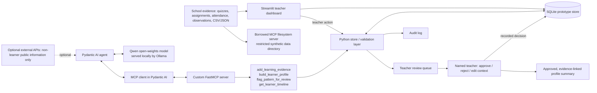

# Mwangaza AI — Architecture

## Goal and guardrails
Mwangaza AI builds a cited, longitudinal learner profile from existing evidence and gives teachers a reviewable summary. It does not rank learners, diagnose them, or assign tracks. Every pattern links to evidence IDs. Guardian communication and consequential pathway guidance are not automated. Prototype data must be synthetic.

## Component map

## Agent shape and workflow
1. Validate incoming evidence (required fields, learner exists, score bounds, source reference).
2. Retrieve the selected learner timeline using MCP.
3. Compare dated evidence and create a draft profile with descriptive patterns and evidence IDs.
4. Create a review task only when a teacher chooses to flag a pattern or the agent workflow calls the review tool.
5. A named teacher reviews evidence and records approve/reject plus a note. This records a decision; it does not automatically send a guardian message.
6. Log tool/application actions with timestamps, actor, inputs, outputs, and result.

## MCP servers
- **Built by this project:** `mwangaza/mcp_server.py`, FastMCP server named `mwangaza-learner-tools`. Tools: `add_learning_evidence`, `build_learner_profile`, `flag_pattern_for_review`, `get_learner_timeline`. Resource: `mwangaza://policy/human-approval`.
- **Borrowed:** community `@modelcontextprotocol/server-filesystem`, restricted to `./data`. It provides generic read/list operations for synthetic evidence files. Reusing it is safer and faster than rewriting generic file access. It is an optional separate process, not required for the dashboard.

## Models, storage, integrations
- **Orchestration:** Pydantic AI.
- **Open-weights LLM:** Qwen via local Ollama OpenAI-compatible endpoint. The model is optional for deterministic dashboard/MCP operations, but the challenge's full-task requirement must be demonstrated by running `mwangaza.agent` successfully on a local model.
- **Database:** SQLite in this local prototype. For multi-user deployment, migrate to PostgreSQL with authentication, authorization, encryption, backups, and retention policy.
- **UI:** Streamlit.
- **External APIs:** none required. Optional web/document APIs must not receive identifiable learner data.

## Security boundaries and known limitations
The dashboard's reviewer name is an attribution field, not authenticated identity. SQLite audit logs are not tamper-proof. There is no production access control, encryption-at-rest configuration, data-retention automation, school identity integration, or guardian messaging integration. Do not deploy publicly or enter real minors' data. Human review gates are implemented in the local workflow; production requires server-side authorization and an explicit guardian-sharing approval flow.
